<p align="center">
  
</p>

# 📊 Awesome Product & Business Analytics

<p align="center">
  <a href="https://github.com/ishandutta2007/Awesome-Awesome-Awesome"></a>
  <a href="https://discord.gg/jc4xtF58Ve"></a>
  <a href="https://github.com/ishandutta2007/Awesome-Awesome-Awesome"></a>
  <a href="#-open-source-github-projects"></a>
  <a href="LICENSE"></a>
  <a href="https://github.com/ishandutta2007"></a>
</p>

> 🚀 A curated directory of top-tier **Product Analytics**, **Business Intelligence (BI)**, behavioral tracking platforms, and **self-hosted open-source data analytics software** to measure retention, conversion funnels, user journeys, and key business metrics.

**📅 Last updated: November 2026**

---

## 📑 Table of Contents
- [🌐 Sector Overview & Market Dynamics](#-sector-overview--market-dynamics)
- [💼 SaaS/Hosted Platforms](#-saashosted-platforms)
- [🔓 Open-Source GitHub Projects](#-open-source-github-projects)
- [🏗️ Architecture & Selection Guide](#️-architecture--selection-guide)
- [🤝 How to Contribute](#-how-to-contribute)
- [💖 Support](#-support)
- [🌟 Star History](#-star-history)
- [⚠️ Disclaimer](#️-disclaimer)

---

## 🌐 Sector Overview & Market Dynamics

📈 The global product analytics and business intelligence (BI) market is estimated at **$33.2 billion in 2026** and projected to exceed **$65 billion by 2032**, expanding at a compound annual growth rate (CAGR) of ~11.8%. 

⚖️ The sector displays a **bifurcated, moderately concentrated market structure**: general enterprise business intelligence is dominated by mega-cap ecosystem suites (Microsoft Power BI, Salesforce Tableau, Google Cloud Looker), while digital product analytics, event-stream tracking, and self-hosted privacy analytics remain a dynamic, moderately fragmented landscape where agile specialized platforms (Mixpanel, Amplitude, PostHog, Heap) compete vigorously on behavioral insight depth, developer experience, and modern data-stack integration.

---

## 💼 SaaS/Hosted Platforms

The following table presents leading hosted and commercial product and business analytics platforms, sorted by **Company Size / Valuation / Market Cap (descending)**.

| Platform | 🏢 Company Size (Market Cap / Valuation / ARR) | 💳 Starting Tier Pricing | 🎁 Free Tier / Trial Limits | 🔍 Key Features & Focus |
| :--- | :--- | :--- | :--- | :--- |
| **[Microsoft Power BI](https://powerbi.microsoft.com/)** | ~$3.1T Market Cap *(Microsoft)* | $10/user/month *(Power BI Pro)* | **Free forever plan** (Power BI Desktop: full authoring & local reporting; publishing/sharing requires Pro or 60-day full Pro trial) | Enterprise business intelligence, deep Office 365/Azure integration, Paginated reports, DAX modeling. |
| **[Google Cloud Looker](https://cloud.google.com/looker)** | ~$2.1T Market Cap *(Alphabet / Google Cloud)* | $5,000/month *(Looker Core Standard instance + user licenses)* | **30-day free trial** with $300 Google Cloud credits (cloud sandbox environment) | Governed enterprise BI, centralized LookML semantic modeling, BigQuery integration, embedded analytics. |
| **[Salesforce Tableau](https://www.tableau.com/)** | ~$280B Market Cap *(Salesforce)* | $15/user/month *(Tableau Viewer; Creator starts at $75/user/month billed annually)* | **14-day free trial** (unrestricted Tableau Cloud/Desktop Creator capabilities) | Gold-standard visual data discovery, ad-hoc drag-and-drop analytics, enterprise data storytelling. |
| **[Atlassian Analytics](https://www.atlassian.com/software/analytics)** | ~$55B Market Cap *(Atlassian)* | $7.90/user/month *(Jira/Confluence Cloud Standard tier; Analytics bundled into Cloud Enterprise)* | **Free forever plan** (up to 10 users for basic Atlassian Cloud products; 30-day trial for Cloud Enterprise tier) | Cross-workspace DevOps & product delivery dashboards; integrates Jira Software, Confluence, and Bitbucket data via Atlassian Data Lake. |
| **[Contentsquare / Heap](https://heap.io/)** | $5.6B Valuation *(Contentsquare acquired Heap)* | $399/month *(Growth tier starting rate; custom scale tiers)* | **Free forever plan** (up to 10,000 monthly sessions, retro-active event autocapture, and 1 user seat) | Digital insights platform featuring retroactive event capture, complete user path journeys, and funnel analysis. |
| **[ThoughtSpot](https://www.thoughtspot.com/)** | $4.5B Valuation | $95/month *(ThoughtSpot Team tier with 1 admin and unlimited view-only users)* | **30-day free trial** (access to Search, Sage GenAI analytics, and live warehouse connectivity) | Search-driven analytics platform with conversational natural language querying (Sage GenAI) over cloud data lakes. |
| **[Pendo](https://www.pendo.io/)** | $2.6B Valuation | $7,000/year *(Starter plan starting at ~$583/month billed annually)* | **Free forever plan** (up to 500 monthly active users [MAU] with 1 web/mobile application guide) | Product experience platform pairing event analytics with in-app guided onboarding walkthroughs, NPS, and feedback. |
| **[Amplitude](https://amplitude.com/)** | ~$1.2B Market Cap *(NASDAQ: AMPL)* | $49/month *(Plus plan starting tier billed annually)* | **Free forever plan** (up to 50,000 monthly tracked users [MTUs], unlimited events, core funnels & retention) | Behavioral analytics graph, cohort analysis, conversion drivers, notebooks, and digital product experimentation. |
| **[Mixpanel](https://mixpanel.com/)** | ~$1.05B Valuation | $20/month *(Growth tier starting base price billed annually)* | **Free forever plan** (up to 20,000 monthly tracked users [MTUs], core reports, and unlimited data history) | Real-time product funnels, retention matrices, behavioral cohort tracking, and interactive product metrics exploration. |
| **[Sisense](https://www.sisense.com/)** | ~$1.0B Valuation | $10,000/year *(Base embedded platform package)* | **30-day free trial** (full access to Sisense Fusion analytical engine, ElastiCube, and SDKs) | Embedded analytics, Fusion data engine for complex multi-source modeling, white-label dashboards, and API customization. |

---

## 🔓 Open-Source GitHub Projects

Explore battle-tested open-source alternatives for product behavioral analytics, event pipelines, self-hosted web metrics, and modern BI semantic layers. Entries are sorted by **GitHub_Stars (descending)**.

| Project | ⭐ GitHub_Stars | 🎯 Primary Domain & Focus | 🛠️ Key Capabilities & Architecture |
| :--- | :--- | :--- | :--- |
| **[Apache Superset](https://github.com/apache/superset)** | [](https://github.com/apache/superset/stargazers) | Enterprise Business Intelligence | Enterprise-ready data visualization and exploration platform (Apache-2.0). Features an intuitive no-code chart builder, SQL Lab IDE, versatile semantic modeling layer, and connectors for 40+ SQL database engines. |
| **[Metabase](https://github.com/metabase/metabase)** | [](https://github.com/metabase/metabase/stargazers) | Self-Service BI & Visual Querying | User-friendly business analytics and visualization tool (AGPL-3.0). Allows non-technical teammates to drill down into data, ask questions visually without SQL, set up automated alert digests, and embed interactive charts. |
| **[PostHog](https://github.com/PostHog/posthog)** | [](https://github.com/PostHog/posthog/stargazers) | All-in-One Product Analytics Suite | Complete developer product toolkit (MIT core / ELv2). Unifies product analytics (funnels, retention, paths), session replay recordings, feature flags, A/B testing experiments, user surveys, and a built-in event warehouse on top of ClickHouse. |
| **[Umami](https://github.com/umami-software/umami)** | [](https://github.com/umami-software/umami/stargazers) | Lightweight Privacy Web Analytics | Fast, privacy-focused open-source alternative to Google Analytics (MIT). Collects traffic metrics, pageviews, referrers, and custom event goals without cookies or invasive user fingerprinting. |
| **[Plausible Analytics](https://github.com/plausible/analytics)** | [](https://github.com/plausible/analytics/stargazers) | Privacy-First Web Analytics | Lightweight (&lt;1 KB script) self-hosted analytics engine (AGPL-3.0) built with Elixir and ClickHouse. Fully GDPR/CCPA compliant out of the box, with clean dashboard metrics and conversion goal tracking. |
| **[Matomo](https://github.com/matomo-org/matomo)** | [](https://github.com/matomo-org/matomo/stargazers) | Full-Featured Web Analytics & Heatmaps | Comprehensive Google Analytics alternative (GPL-3.0) providing 100% data ownership. Offers heatmaps, session recordings, A/B testing, form tracking, multi-channel attribution, and an extensive plugin ecosystem. |
| **[Cube](https://github.com/cube-js/cube)** | [](https://github.com/cube-js/cube/stargazers) | Universal Semantic Layer & Metrics Store | Semantic data layer for building analytics applications (Apache-2.0). Provides metric definition modeling, enterprise caching, SQL API, REST API, and GraphQL endpoints to power BI frontends and custom portals. |
| **[OpenReplay](https://github.com/openreplay/openreplay)** | [](https://github.com/openreplay/openreplay/stargazers) | Session Replay & Product Observability | Self-hosted session recording and replay platform (ELv2) that pairs visual user journeys with DevTools telemetry (network requests, console logs, Redux state, and JS errors) to understand why users drop off. |
| **[GrowthBook](https://github.com/growthbook/growthbook)** | [](https://github.com/growthbook/growthbook/stargazers) | Feature Flags & Experimentation Engine | Open-source A/B testing and feature flagging platform (MIT / EE). Plugs directly into your existing data warehouse (Snowflake, BigQuery, ClickHouse, Redshift) without requiring duplicate data storage. |
| **[Lightdash](https://github.com/lightdash/lightdash)** | [](https://github.com/lightdash/lightdash/stargazers) | dbt-Native BI & Metrics Platform | Modern business intelligence platform (MIT core) that turns your dbt project into a self-service BI tool. Metrics defined in dbt become immediately queryable, governed charts and dashboards for business stakeholders. |
| **[Countly](https://github.com/Countly/countly-server)** | [](https://github.com/Countly/countly-server/stargazers) | Mobile & Web Product Analytics | Real-time product and customer journey analytics platform (AGPL-3.0 / Community Edition). Specializes in mobile app SDK telemetry, push notification campaign tracking, crash analytics, and user engagement funnels. |
| **[Jitsu](https://github.com/jitsucom/jitsu)** | [](https://github.com/jitsucom/jitsu/stargazers) | Event Ingestion & CDP Pipeline | Open-source data collection pipeline and Segment alternative (MIT). Captures event streams from client and server SDKs, transforms events with JavaScript functions, and batches data in real-time into modern warehouses and BI destinations. |

---

## 🏗️ Architecture & Selection Guide

When architecting a product and business analytics stack, determine whether your primary need is **in-app behavioral tracking** or **cross-functional business reporting**:

```
                                ┌───────────────────────────────────────┐
                                │          User Interaction             │
                                │    (Web, Mobile Apps, Backend APIs)    │
                                └──────────────────┬────────────────────┘
                                                   │
                         ┌─────────────────────────┴────────────────────────┐
                         ▼                                                  ▼
          ┌─────────────────────────────┐                    ┌─────────────────────────────┐
          │  Product Analytics & UX     │                    │  Data Pipeline & Storage    │
          │  (PostHog / Mixpanel /      │                    │  (Jitsu / Segment / Kafka)  │
          │   Amplitude / OpenReplay)   │                    └──────────────┬──────────────┘
          └──────────────┬──────────────┘                                   │
                         │                                                  ▼
                         │                                   ┌─────────────────────────────┐
                         │                                   │ Modern Data Warehouse (DWH) │
                         │                                   │ (ClickHouse/Snowflake/BQ)   │
                         │                                   └──────────────┬──────────────┘
                         │                                                  │
                         ▼                                                  ▼
          ┌─────────────────────────────┐                    ┌─────────────────────────────┐
          │ Behavioral Product Insights │                    │ Business Intelligence (BI)  │
          │ • Funnels & Conversion      │                    │ • Superset / Metabase       │
          │ • Cohort Retention          │                    │ • Power BI / Tableau        │
          │ • Session Replay & Flags    │                    │ • Company KPI Dashboards    │
          └─────────────────────────────┘                    └─────────────────────────────┘
```

1. **For Pure Product & Behavioral Analytics**: Choose **PostHog** (if you want self-hosted, all-in-one flags, replays, and experiments) or **Mixpanel / Amplitude** (if you prioritize managed turn-key UX with instant cohort computations).
2. **For Business Intelligence & Operational Dashboards**: Choose **Apache Superset** (for data engineers/SQL analysts requiring deep visualization) or **Metabase** (for non-technical business users seeking rapid self-service query exploration).
3. **For Privacy-Focused Site Analytics**: Choose **Umami** or **Plausible** to capture clean, cookie-less traffic and goal conversion metrics without privacy overhead.
4. **For Governed Metrics over Warehouse/dbt**: Pair **Cube** or **Lightdash** with your cloud data warehouse to avoid divergent metric definitions between BI dashboards.

---

## 🤝 How to Contribute

Contributions are welcome! To add a product or open-source tool:
1. 🍴 Fork this repository.
2. 📝 Add the tool to the appropriate table matching the existing column layout.
3. 💲 Ensure pricing and free tier limits are exact and verifiable.
4. ⭐ Verify repository Stars_Count and include the social shield badge linked to `/stargazers`.
5. 🚀 Submit a pull request with a clear description of the project.

---

## 💖 Support

Thank you for visiting and supporting this ecosystem directory! If you find this curated list valuable, please consider:
- ⭐ **Starring** this repository on GitHub to boost visibility.
- 🍴 **Forking** it to customize your team's analytics stack and contribute back.
- 📢 **Sharing** it with data engineers, product managers, and founders.
- ☕ **Buying a coffee / sponsoring** via the [GitHub Sponsors Dashboard](https://github.com/sponsors/ishandutta2007) to help maintain continuous updates!

---

## 🌟 Star History

[](https://star-history.dera.page/#ishandutta2007/Awesome-Product-Business-Analytics&type=date&legend=top-left)

---

## ⚠️ Disclaimer

- This list is community-curated for informational purposes and does not represent a commercial endorsement.
- All product names, logos, and brands are property of their respective owners.
- When tracking user behavior and telemetry, ensure compliance with global data privacy regulations (GDPR, CCPA, HIPAA). Operators of self-hosted solutions maintain full responsibility for event collection policies, consent management, and data retention.
